<div align="center">

# EventFlow

### One workspace for event discovery, bookings, and wedding planning.

**Explore events. Manage bookings. Plan meaningful celebrations.**

A full-stack web application built with **Python, Flask, SQLite, HTML, CSS, and JavaScript**.

[Product Overview](#01-product-introduction) · [Customer Experience](#02-customer-event-booking-experience) · [Wedding Management](#03-wedding-management-system) · [Admin Operations](#04-admin-operations) · [Architecture](#06-system-architecture) · [Setup](#10-local-setup-and-installation)

</div>

---

## Contents

- [01. Product Introduction](#01-product-introduction)
- [02. Customer Event-Booking Experience](#02-customer-event-booking-experience)
- [03. Wedding Management System](#03-wedding-management-system)
- [04. Admin Operations](#04-admin-operations)
- [05. Product Problems and Engineering Decisions](#05-product-problems-and-engineering-decisions)
- [06. System Architecture](#06-system-architecture)
- [07. Technology Stack](#07-technology-stack)
- [08. Data Model and Core Workflows](#08-data-model-and-core-workflows)
- [09. Repository Structure](#09-repository-structure)
- [10. Local Setup and Installation](#10-local-setup-and-installation)
- [11. Testing and Verification](#11-testing-and-verification)
- [12. Security, Reliability, and Limitations](#12-security-reliability-and-limitations)
- [13. Product Demonstrations](#13-product-demonstrations)

---

# 01. Product Introduction

EventFlow brings event discovery, event booking, administrative operations, and wedding-planning workflows into one web application. It is designed for three audiences:

- **Event customers** who want to browse event categories, inspect event details, and use the available booking and account workflows.
- **Wedding customers** who want to explore predefined wedding themes and submit wedding-planning information through a dedicated experience.
- **Administrators** who need to manage event information, review bookings, and oversee wedding-related records.

### The problem

Event information, booking records, and wedding-planning details can become scattered across separate pages and manual processes. Customers need clear information about their activity, while administrators need a practical way to maintain records and review requests.

### The approach

EventFlow connects supported parts of these journeys in a single Flask application. The same application serves customer-facing pages and administrative workflows, with SQLite storing the application's records.

### At a glance

| Area | What EventFlow provides |
|---|---|
| Event discovery | Category-based browsing and event detail pages |
| Accounts | Sign-up, login, profile-related functionality |
| Booking | Event-booking workflow and booking records |
| Wedding planning | Theme catalogue and wedding-related request/booking records |
| Administration | Dashboard and event/booking management interfaces |
| Data handling | SQLite persistence and available CSV export functionality |
| Security work | Password hashing, database-backed admin role checks, environment-based secrets |

### Technology

[](https://www.python.org/)
[](https://flask.palletsprojects.com/)
[](https://www.sqlite.org/)
[](https://developer.mozilla.org/en-US/docs/Web/HTML)
[](https://developer.mozilla.org/en-US/docs/Web/CSS)
[](https://developer.mozilla.org/en-US/docs/Web/JavaScript)

The badges identify the core technologies known to be used in the application. Exact dependency versions and the complete dependency list should be maintained in `requirements.txt`.

---

# 02. Customer Event-Booking Experience

The customer-facing experience is organized around finding an event, reviewing its details, and using the application's supported booking workflow.

## Typical journey


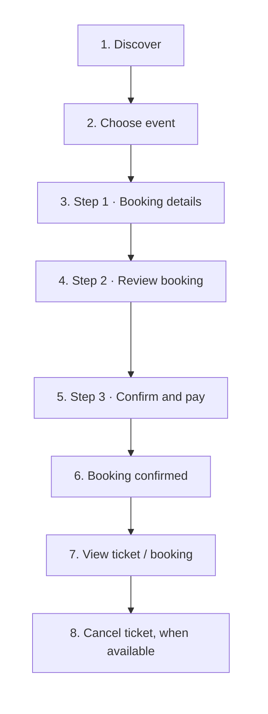
The three-step sequence summarizes the customer booking journey. PayPal is used in the configured Sandbox flow for payment testing; a successful sandbox transaction is not a live payment. Ticket cancellation is shown as a supported customer action where the relevant booking controls are available.

## What the user does

1. **Discover:** Browse event categories and available event cards.
2. **Evaluate:** Open an event page to review the information displayed by the application, such as its description, date, location, and price where available.
3. **Authenticate:** Create an account or log in when required by the selected action.
4. **Book:** Complete the booking steps provided by the current application.
5. **Review:** Use the available confirmation, profile, or booking views to review the resulting information.

### Payment and follow-up

PayPal Sandbox supports payment-flow testing; it does not represent live payment processing or real-money settlement. Email confirmation is available where the application’s email configuration and workflow trigger it.

**Demonstration:** See [Product Demonstrations](#13-product-demonstrations).

---

# 03. Wedding Management System

EventFlow includes a dedicated wedding experience built around predefined themes and wedding-related records. It is intended to keep theme discovery and wedding information within the same application as event management.

## Available themes

The application includes five wedding themes:

| Theme | Description |
|---|---|
| Royal Palace Theme | Royal architecture, luxurious décor, and timeless grandeur |
| Beach Wedding Theme | Coastal scenery, natural beauty, and relaxed seaside elegance |
| Rustic Garden Theme | Garden charm, natural textures, and earthy details |
| Traditional Cultural Theme | Cultural traditions, heritage décor, and ceremonial elegance |
| Modern Minimalist Theme | Contemporary design, clean details, and refined simplicity |

## Customer journey

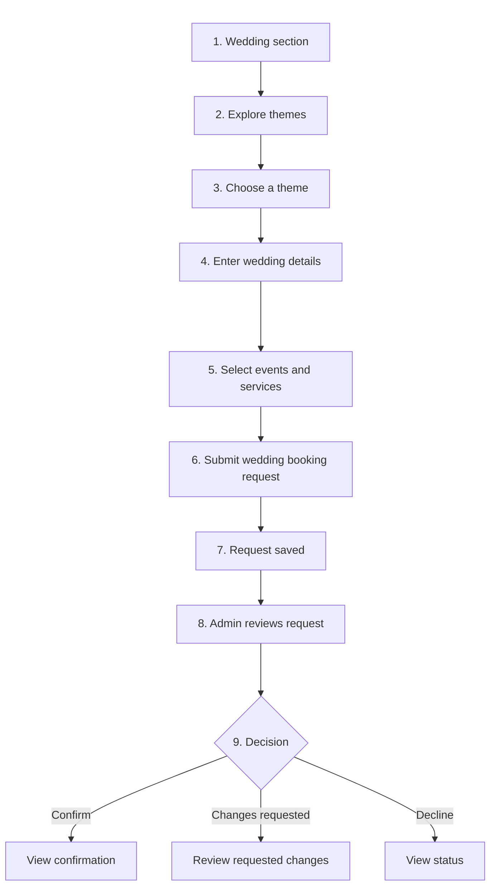
The code context confirms that the wedding request form stores structured wedding details and reports that the request was submitted for administrator confirmation. The current workflow also defines canonical statuses including `new_request`, `under_review`, `changes_requested`, `confirmed`, `declined`, and `cancelled`, with legacy status aliases.

A **submitted request is not the same as a confirmed wedding**. Confirmation should be communicated only after the application records the confirmed state. The precise behavior of customer status displays, date changes, notifications, and any post-approval schedule must be checked against the current routes and templates before making stronger claims.

The request form has included information such as wedding date, guest count, venue/location, contact information, selected events, services, optional add-ons, preferences, and contact preferences. The exact required fields may vary with the current form implementation.

**Demonstration:** See [Product Demonstrations](#13-product-demonstrations) for the wedding recording plan.

---

# 04. Admin Operations

EventFlow has two distinct administrative work areas: **event operations** and **wedding management**. They share the application but support different workflows.


<h2>Admin Dashboard</h2>

<p align="center">
  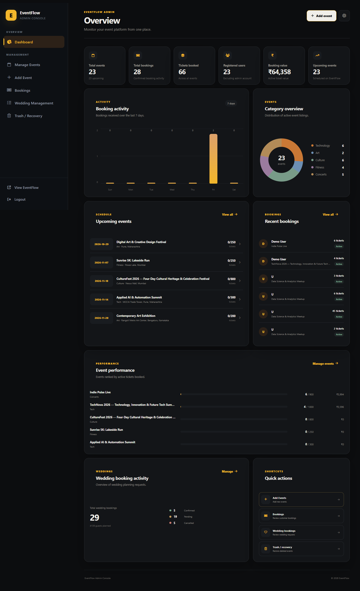
  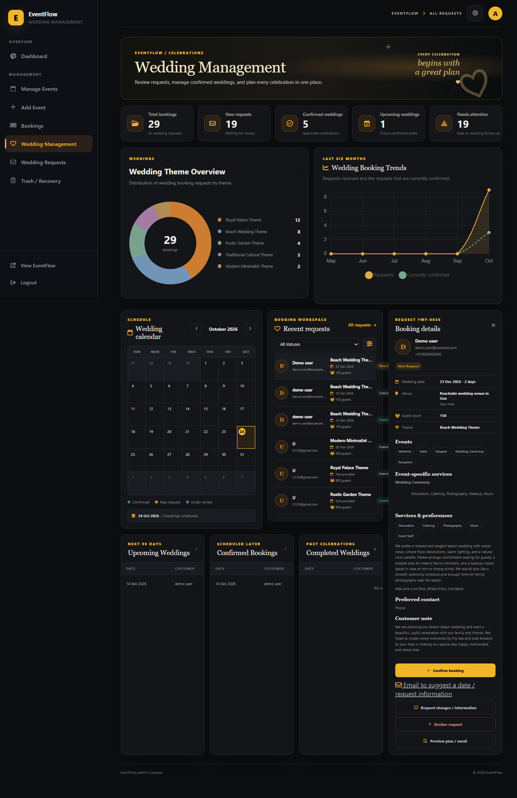
</p>

*EventFlow's administrative dashboard.*

## Event operations


Manage the five event categories—Tech, Art, Culture, Fitness, and Wedding Themes—through the available event-management and event-booking workflows.

| Area | Purpose |
|---|---|
| Event dashboard | Review the event-administration overview and available summary metrics |
| Manage events | Create and maintain event information across the event catalogue |
| Event bookings | Review customer event-booking records |
| Categories | Work with Tech, Art, Culture, Fitness, and the Wedding Themes entry point; wedding planning itself is handled separately below |
| CSV export | Export available administrative records where supported |

## Wedding management

Wedding management follows its own workflow for wedding bookings and requests.

| Area | Purpose |
|---|---|
| Wedding dashboard | Review wedding-related summaries and requests |
| Wedding bookings / requests | Open and review submitted wedding information |
| Request status | Review and update supported wedding-request states |
| Wedding planning records | Work with wedding-specific details, selected events, guests, and related information where available |

The wedding-management interface has included status categories, filtering/search controls, calendar-oriented views, upcoming and completed groupings, and summary data. Exact behavior depends on the current routes and records.

## Authorization approach

Administrative checks use the logged-in user's role stored in the database. Targeted local tests confirmed that a normal account could not gain administrator access merely by setting its session username to `admin`. This is a specific authorization improvement, not a claim that every security risk in the entire application has been eliminated.

**Demonstration:** See [Product Demonstrations](#13-product-demonstrations).

---

# 05. Product Problems and Engineering Decisions

EventFlow is a useful exercise in connecting multiple workflows while keeping their data and permissions understandable. The following decisions reflect the implementation context and the work performed so far.

| Problem or constraint | Engineering approach | Benefit | Remaining consideration |
|---|---|---|---|
| Customer and administrator actions have different permissions | Use the account's database role for administrator checks | Avoid relying only on a session username for privileged access | Continue auditing all privileged routes and state-changing actions |
| Passwords must not be stored as plain text | Use Werkzeug password hashing and verification | Stored password values are hashes rather than readable passwords | Review password reset, session security, and operational configuration before deployment |
| Application secrets should not live in source code | Load the Flask secret from local environment configuration | Secret values can be kept outside committed source files | Each deployment needs its own strong secret and configuration |
| Wedding requests have more than one possible outcome | Represent wedding statuses with canonical values and aliases for legacy values | The application can distinguish new requests, review, changes, confirmation, decline, and cancellation | Confirm that every transition and customer-facing status is handled consistently |
| Wedding requests contain multiple selections | Store structured selections and preferences in wedding-related records, including JSON-formatted fields where used | Related planning information can be retained together | Validate JSON shape and fields consistently; consider future normalization if querying becomes complex |
| Developers need a safe way to start with their own data | Keep the local database out of the public repository and prepare a database initialization script | Public source can be separated from private user and booking records | Fresh-database setup must be completed and tested before release |
| Payment testing differs from real payment processing | Use the PayPal Sandbox flow where configured | Payment behavior can be exercised without claiming live settlement | Live payment configuration, reconciliation, webhooks, and production credentials are outside the claim of a sandbox demo |

## Example: a submitted wedding request

A request moves from customer input to a persistent record, then into the administrator's review workflow. Keeping the request state explicit makes it possible to distinguish a request awaiting review from a confirmed wedding.

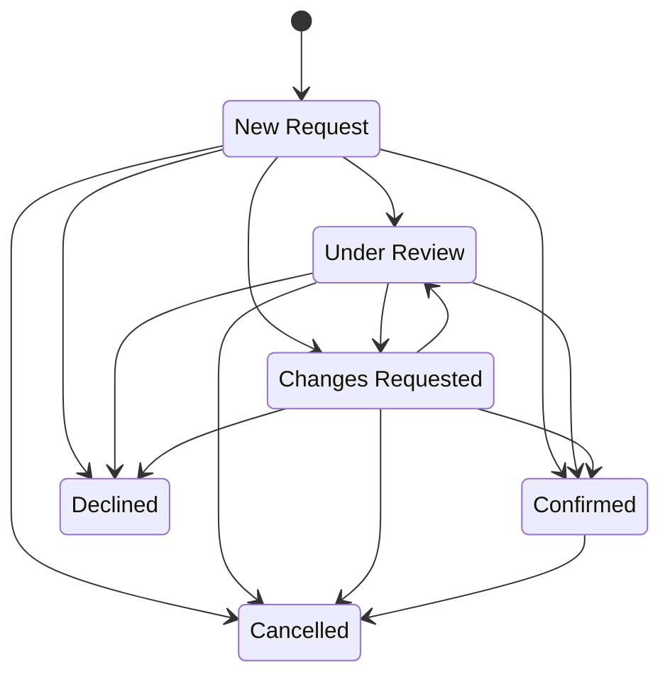

The diagram summarizes the transition rules defined in the application context; it does not imply that all transitions have been exercised in a full automated test suite.

---

# 06. System Architecture

EventFlow uses a Flask application with server-rendered pages, static frontend assets, application utilities, and an SQLite database. The browser submits requests to Flask routes; route handlers apply application logic and interact with the database before rendering a response or redirecting the user.

## High-level architecture

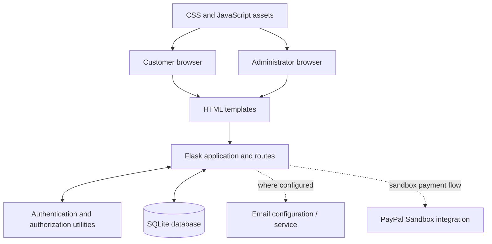

Email and PayPal are shown as integrations used or configured by the application context. Their availability depends on the actual environment configuration and the relevant workflow; they should not be assumed to work in every local setup.

## Customer booking request sequence

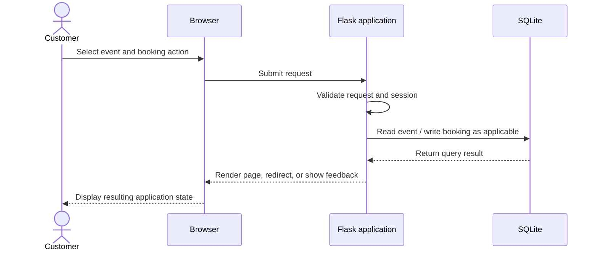

## Wedding request and review sequence

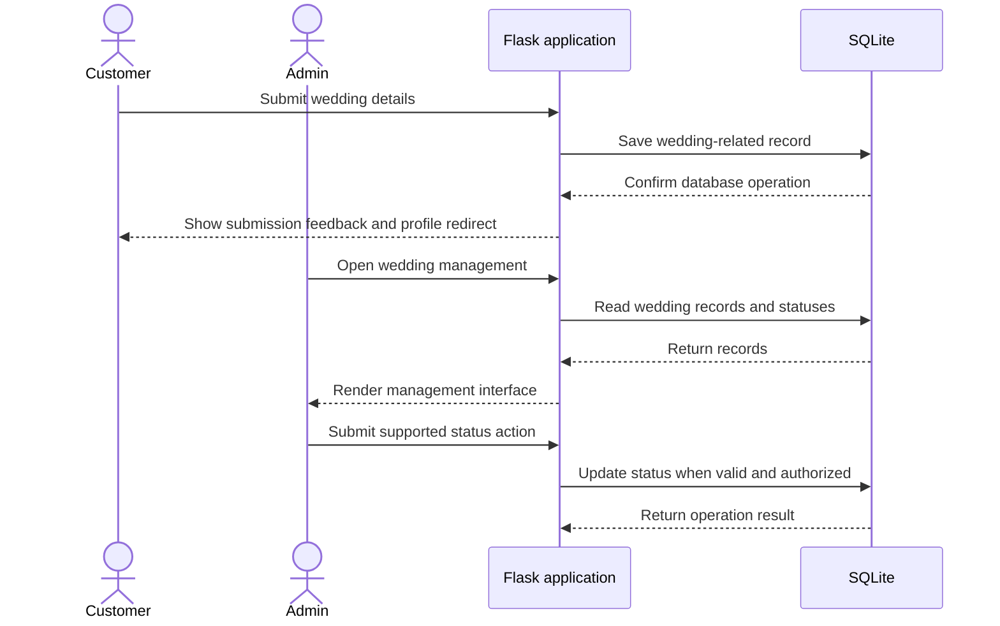

## Component responsibilities

- **Browser interface:** Displays pages, forms, navigation, and client-side interactions.
- **Flask routes:** Handle HTTP requests, coordinate workflows, and render templates or redirect.
- **Authentication utilities:** Hash and verify passwords and support time-limited reset tokens.
- **Authorization checks:** Use the logged-in user's database role for administrative access.
- **SQLite:** Persists account, event, booking, theme, and wedding-related records.
- **External integrations:** Email and sandbox payment behavior depend on their configuration and implementation.

---

# 07. Technology Stack

| Technology | Role in EventFlow |
|---|---|
| Python | Application language and backend logic |
| Flask | Routing, request handling, sessions, and template rendering |
| SQLite | Relational persistence for application records |
| HTML | Server-rendered page structure |
| CSS | Layout, styling, and responsive presentation |
| JavaScript | Browser-side interactions |
| Werkzeug security utilities | Password hashing and verification |
| itsdangerous | Time-limited token signing and verification |
| python-dotenv | Loading local environment variables |
| PayPal Sandbox | Test payment workflow where configured |
| CSV support | Export of available administrative data |

The project should publish a `requirements.txt` generated and reviewed from the actual environment. Do not treat the table above as a substitute for a tested dependency lock or dependency list.

---

# 08. Data Model and Core Workflows

The development database contains these confirmed tables:

- `users`
- `events`
- `bookings`
- `wedding_themes`
- `theme_events`
- `wedding_bookings`
- `wedding_guests`

The exact columns and constraints should be taken from the database initialization script and current schema. The local database is intentionally not part of the public repository.

## Conceptual relationship diagram

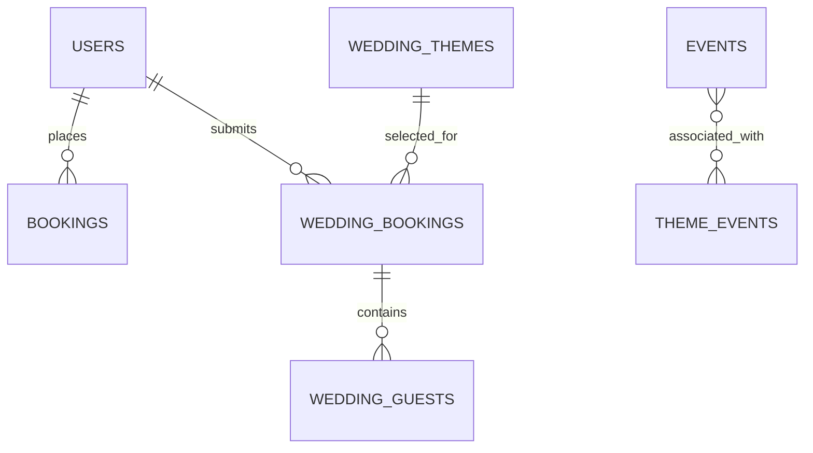

This is a conceptual view of the known entities, not a complete schema specification. Exact foreign keys—especially the relationship between `events` and `theme_events`—must be verified in the initialization script before treating this diagram as authoritative.

### Data safety

The local database may contain account identifiers, email addresses, password hashes, bookings, and wedding details. Do not publish the working database or use real personal information in screenshots. A fresh-install script should create the schema and intended default wedding themes without copying personal records.

---

# 09. Project Structure

```text
EventFlow/
├── app.py
├── requirements.txt
├── README.md
├── .gitignore
├── .env.example
├── templates/                 # HTML templates
├── static/
│   ├── css/                   # Stylesheets
│   ├── js/                    # JavaScript files
│   └── images/                # Website and wedding theme images
├── utils/
│   └── auth_utils.py          # Authentication utilities
└── database/                  # Local database files are excluded
```
---

# 10. Local Setup and Installation

These instructions describe the intended local setup. The first public release should be tested from a clean checkout after the dependency file and database initialization script are complete.

## Prerequisites

- Python installed and available as `python`
- PowerShell on Windows, or a compatible terminal
- Git for cloning the repository
- A browser

## 1. Clone the repository

Replace the placeholders after the GitHub repository has been created:

```powershell
git clone <repository-url>
cd <repository-folder>
```

## 2. Create a virtual environment

```powershell
python -m venv .venv
.\.venv\Scripts\Activate.ps1
```

If PowerShell blocks activation, use the Python executable inside `.venv` directly or follow the official Python/PowerShell environment guidance for your machine.

## 3. Install dependencies

After `requirements.txt` is generated and tested:

```powershell
python -m pip install -r requirements.txt
```

## 4. Configure environment variables

Create a local `.env` file in the project root. Never copy real secret values into the README.

Example format only:

```dotenv
EVENTFLOW_SECRET_KEY=replace-with-a-unique-random-secret
EVENTFLOW_PASSWORD_RESET_SALT=replace-with-a-separate-random-value
```

Generate unique values for your own environment. Do not use the example values literally. If email or payment configuration is required for a workflow, configure it according to the relevant code and provider's sandbox documentation.

## 5. Initialize a fresh database

`init_db.py` is planned as the reproducible setup path. Once it is present and tested, run the exact command documented in that script's instructions.

**Do not run a database initialization command against an existing database you want to keep.** Back up local data before any schema change or reset.

## 6. Start the application

The current development entry point is `app.py`:

```powershell
python app.py
```

Open the local URL printed by Flask in the terminal. The default Flask development server commonly uses `http://127.0.0.1:5000/`, unless the application configures another host or port.

Use the application's sign-up flow for a normal account. Administrator setup must follow a documented, safe local process; do not publish the private database or administrator credentials.

## Troubleshooting

| Symptom | What to check |
|---|---|
| `ModuleNotFoundError` | Activate the intended virtual environment and install dependencies |
| Missing environment variable | Confirm `.env` exists locally and contains the required variable names |
| Database/table error | Confirm the fresh database was initialized using the matching schema |
| Email does not send | Check email configuration and provider credentials; do not expose them in logs |
| Sandbox payment fails | Verify sandbox credentials and callback/configuration requirements |
| Admin page redirects to login | Confirm the logged-in account's database role and session; do not spoof a username |

---

# 11. Recommended Test

Key workflows to verify before a release:

- **Accounts:** Registration, login, and invalid-password rejection.
- **Events:** Browse categories and inspect event details.
- **Booking:** Complete Steps 1–3, test PayPal Sandbox where configured, and verify confirmation.
- **Tickets:** View booking details and test cancellation where available.
- **Email:** Verify booking confirmation using test configuration.
- **Weddings:** Submit a wedding booking request and verify its appearance in wedding administration.
- **Administration:** Test wedding status actions, admin access restrictions, and CSV export permissions.
- **Setup:** Start the application using the documented dependencies and a separate development database.

---

# 12. Security and Limitations

- Passwords use Werkzeug hashing and verification; the Flask secret and password-reset salt are loaded from local environment configuration.
- Administrative access uses a database-backed role check. Keep `.env`, local databases, backups, and personal booking data out of the public repository.
- PayPal Sandbox is for testing, not live payment processing. Email delivery depends on the local email configuration.
- Fresh-database initialization and a reproducible dependency list should be verified before a clean public checkout can be considered ready.
- Before deployment, review CSRF protection, session-cookie settings, input validation, logging, backups, and production configuration.

---

# 13. Product Demonstrations

## Event discovery and booking

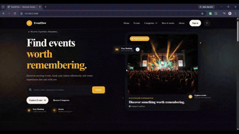

## Wedding booking experience

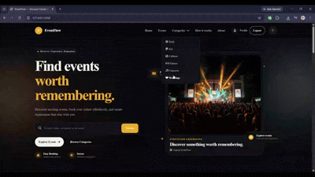

## Wedding booking administration

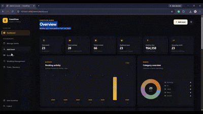

## Event administration

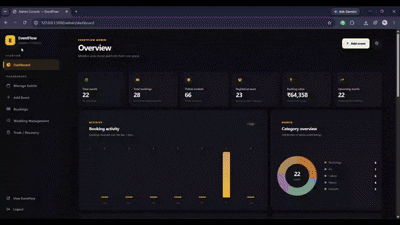

---

<div align="center">

**EventFlow** · Event discovery · Booking workflows · Wedding planning

*Built with Python, Flask, SQLite, HTML, CSS, and JavaScript — bringing event booking and wedding-management workflows together in one application.*

</div>
